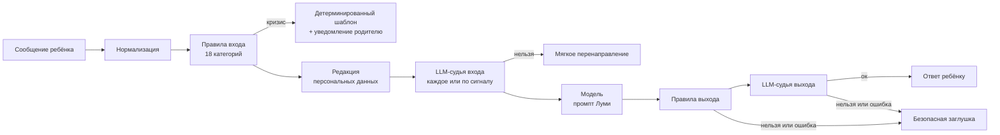

# ChildGPT — безопасный ИИ-собеседник для детей

ИИ-собеседник для детей 5–13 лет: ребёнок общается с совёнком Луми, а регистрируются и управляют всем только родители. Главное в проекте — **контур защиты**: ни одно слово не доходит до ребёнка, пока его не проверили правила и отдельная модель-судья, а любая ошибка в контуре даёт безопасную заглушку, а не «показать как есть».

pnpm-монорепозиторий на TypeScript: контур защиты отдельным пакетом, API на Express + MongoDB, сайт на Next.js 15 (лендинг, кабинет родителя, детский чат). **185 тестов**, из них 166 — на контур защиты, включая red-team кейсы.

## Где здесь ИИ-инженерия

| Задача | Как решено |
| --- | --- |
| Модель может сказать ребёнку недопустимое | Ответ **никогда не стримится**: он показывается только после проверки правилами и LLM-судьёй выхода. Сгенерированный текст, не прошедший проверку, заменяется безопасной репликой |
| Ошибка в защите не должна открывать дверь | Fail-closed на каждом шаге: упал судья, не разобрался JSON, истёк таймаут — ребёнок получает безопасную заглушку |
| Обходы фильтров: «х*й», «с у к а», «cyka», «пиииздец», невидимые символы | Нормализация перед правилами: склейка разрывов, латиница и цифры, похожие на кириллицу, повторы букв. Нормализованный текст — только для сопоставления, модели и родителю уходит исходный |
| Кризис: самоповреждение, насилие, давление взрослых | Кризисные ответы — только **детерминированные шаблоны** с телефоном доверия, без генерации; родитель получает уведомление |
| Ребёнок пишет телефон, адрес, почту | Редакция персональных данных до отправки модели; ребёнку — мягкое объяснение, почему так не надо |
| Попытки «сломать» модель (jailbreak) | Отдельная категория правил и судья входа: в строгом режиме проверяется каждое сообщение, в обычном — только сработавшие на правилах |
| Ложные тревоги раздражают родителей | Если правила отклонили собственный ответ модели, родитель не получает тревогу — это не действие ребёнка |

**Правила** покрывают 18 категорий: кризисы (самоповреждение, насилие над ребёнком), контакты с незнакомцами, персональные данные, сексуальный контент, насилие, оружие, наркотики, алкоголь и табак, азартные игры, экстремизм, ненависть, травля, опасные занятия, медицина, мат, jailbreak и другие. Каждое новое правило добавляется вместе с тестами на то, что оно ловит, и на то, что оно **не должно** ломать.

## Как проходит сообщение



## Возможности

- **Кабинет родителя:** профили детей с возрастом и темой оформления, дневные лимиты, история и журнал событий безопасности, уведомления о тревожных сигналах.
- **Детский режим:** чат с Луми в оформлении под ребёнка; выйти из детского режима можно только по паролю родителя.
- **Строгий режим:** судья проверяет каждое сообщение, а не только помеченные правилами.
- **Языковая модель** подключается через асинхронный API моего LLM-шлюза [Siberi](https://github.com/LDRION/siberi), поднятого локально с `PORT=5005` (`SIBERI_BASE_URL`); для разработки без ключа — `LLM_PROVIDER=mock`.

## Монорепозиторий

| Путь | Что внутри | Объём |
| --- | --- | --- |
| `packages/safety` | Контур защиты: нормализация, правила, редакция персональных данных, LLM-судьи входа и выхода, детерминированные ответы, конвейер | ~1 200 строк + 365 строк тестов |
| `packages/shared` | Типы API, темы, фигуры маскота, константы | ~340 строк |
| `apps/api` | Express + MongoDB: вход родителей, профили детей, детский режим, безопасный чат, уведомления | ~1 100 строк |
| `apps/web` | Next.js 15: лендинг, кабинет родителя, детский чат | ~5 100 строк |

## Стек

**ИИ:** LLM-судьи входа и выхода с разбором JSON, правила с нормализацией текста, редакция персональных данных, промпт персонажа, fail-closed конвейер.
**Бэкенд:** Node.js, TypeScript, Express, MongoDB.
**Фронтенд:** Next.js 15, React, TypeScript.
**Качество:** Vitest (166 тестов контура защиты, 19 сквозных тестов API), строгий TypeScript, pnpm workspaces.

## Запуск

Нужны Node.js 22+, pnpm и MongoDB.

```powershell
pnpm install
copy apps\api\.env.example apps\api\.env      # AUTH_SECRET; ключ модели или LLM_PROVIDER=mock
copy apps\web\.env.example apps\web\.env.local
pnpm dev:api
pnpm dev:web
pnpm test        # все тесты, в том числе red-team кейсы контура защиты
pnpm typecheck
```

Мобильное приложение для iOS и Android на Expo — следующий шаг: API уже общий для сайта и приложения.
